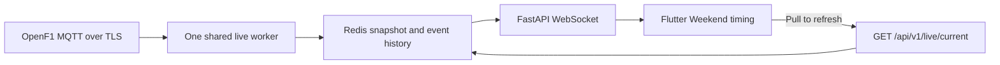

# RacePulse live timing

Live timing is implemented with **no additional 20-second release buffer**. Every accepted OpenF1 push is immediately written to the shared Redis snapshot and broadcast to Flutter. Provider latency, network transport, and processing still apply; the app does not promise an exact three-second delay.

The Weekend page now has pull-to-refresh and a refresh button. The timing panel shows the top five drivers, with controls for the full field, sectors, last completed lap, gaps, tyre compound/age, pit information, weather, and the latest race-control message. Data age means **time since RacePulse received an update**, rather than a measurement of provider latency.

## Enable actual live delivery

The current backend environment has live timing disabled and no live credentials configured. Local Redis at `localhost:6379` was unavailable during verification, and Docker Desktop's engine was not running. No provider subscription was purchased, and no secrets were added to the app or repository.

1. Obtain your paid OpenF1 live credentials. See the [OpenF1 authentication guide](https://openf1.org/auth.html).
2. In `C:\Users\ShawnMatunda\PycharmProjects\racepulse\.env`, set these server-only values:

   ```dotenv
   OPENF1_LIVE_ENABLED=true
   OPENF1_USERNAME=your-provider-username
   OPENF1_PASSWORD=your-provider-password
   REDIS_URL=redis://localhost:6379/0
   ```

3. Start Redis and restart the backend API using your existing backend startup procedure. From the backend project folder, start the collector in a separate terminal:

   ```powershell
   .\.venv\Scripts\python.exe -m app.workers.live_worker
   ```

   The existing Compose file also now includes a `live-worker` service. When using your configured Compose deployment, pass the same OpenF1 environment values to both the API and this worker. The worker remains idle while live access is disabled.

4. Open Weekend in the rebuilt app. During an eligible session, the collector hydrates the current board and subscribes to updates. Outside the session window, the panel waits for the next session. Pulling down reloads the shared snapshot; it does not create another provider subscription.

For a hosted browser frontend, configure `CORS_ALLOWED_ORIGIN_REGEX` for your actual frontend origin. The current local default accepts localhost/127.0.0.1 origins. The socket uses WSS automatically when the API URL uses HTTPS.

## Delivery and recovery



- `GET /api/v1/live/current` returns the latest shared snapshot.
- `WS /api/v1/live/stream` sends a snapshot on connection, immediate snapshots on accepted updates, and periodic freshness checks.
- Session selection uses an exact provider session key and the provider's start/end dates, including its 30-minute access windows. Historical or cancelled sessions are not treated as live. Session discovery runs once per minute; already connected timing updates are pushed without a release timer.
- A renewable Redis lease and atomic publication prevent multiple workers from publishing concurrently. Lease expiry permits takeover after a worker failure.
- The collector subscribes before loading the REST snapshot. On reconnect, it rebuilds the snapshot, merges queued partial laps, and protects newer positions/laps from older updates. Tokens refresh before expiry; provider failures reconnect with backoff.
- Snapshot epoch and sequence numbers prevent slow refresh responses and older socket messages from replacing newer timing. The app checks update age, reconnects when the socket goes quiet, and refreshes on return to the foreground.
- The board has waiting, reconnecting, unavailable, and finished states. A stale board retains its last values with an explicit status rather than remaining labelled live.
- Redis stores a bounded event stream for seven days, using the existing Compose Redis persistence. Long-term PostgreSQL recording of the live feed and moving-car telemetry are future work; existing recorded-session tools remain available through their existing imports.

## Verification

- **56 frontend tests passed**, including immediate updates, out-of-order snapshot rejection, reconnects, a slow refresh crossing collector epochs, stale data, pull-to-refresh on a short page, and the full field at 320 pixels with enlarged text. Existing Paddock, calendar, navigation, and weekend checks passed.
- **27 backend tests passed**, covering provider authentication, session selection, immediate publication, reconnect backfill, sector merging, Redis Lua lease fencing/snapshot broadcast, WebSocket snapshots, and existing calendar APIs/services.
- Changed Flutter files have no analyzer issues. Backend lint passes. Full-project Flutter analysis also reports existing informational lints outside these changes.
- Windows debug build succeeded: `C:\Users\ShawnMatunda\AndroidStudioProjects\Racepulse\build\windows\x64\runner\Debug\racepulse.exe`.
- Provider/network behavior used documented OpenF1 protocols and fixtures. Redis scripts used a Lua-capable Redis test harness. Authenticated race delivery and a running production Redis instance are **not yet verified**.

Frontend branch: `codex/paddock-editorial-search`. Backend remains on `Home-Page`. Changes are local and uncommitted.

References: [OpenF1 endpoints](https://openf1.org/docs/), [OpenF1 streaming authentication](https://openf1.org/auth.html), [OpenF1 latency and live windows](https://openf1.org/).
